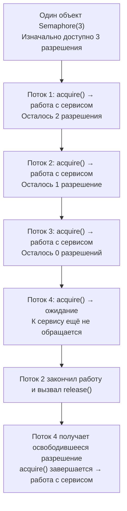

# Semaphore: как ограничить число одновременно работающих потоков

**CON-SEM · Java 21 · основные знания: Middle; дополнительные нюансы: Middle+**

## Задача: нельзя обращаться к ресурсу без ограничений

Представим программу, которая отправляет запросы во внешний сервис. Одновременно работать с ним могут **не более трёх потоков**: если запросов станет больше, сервис может оказаться перегружен.

**Поток** — выполняющаяся последовательность инструкций Java. Несколько потоков могут одновременно вызвать один и тот же метод у одного объекта. **Вызов метода** — действие потока, а не отдельный поток.

Наша цель: разрешить любым трём потокам выполнять обращение к сервису, а **четвёртый должен подождать**, пока один из них не закончит. При этом создавать или останавливать потоки ради ограничения не нужно.

Для этого подходит `Semaphore`.

## Как работает семафор

**`Semaphore`** — объект из `java.util.concurrent`, который учитывает количество доступных **разрешений** (*permits*). Разрешение — не отдельный объект и не физический ресурс: семафор хранит **счётчик**.

Создадим `new Semaphore(3)`. Теперь при обращении к сервису каждый поток действует по одинаковому правилу:

1. Вызывает `acquire()` **до** обращения к сервису. Если счётчик больше нуля, семафор уменьшает его на единицу и метод сразу завершается.
2. Если разрешений не осталось, `acquire()` **не завершается**: вызвавший его поток ожидает и пока не выполняет обращение к сервису.
3. После завершения обращения поток вызывает `release()`: семафор увеличивает число доступных разрешений на единицу. Один из ожидающих потоков теперь может продолжить выполнение.

**Важно:** не семафор вызывает сервис. Сервис вызывает **сам поток**, но только после успешного `acquire()`.

### Четыре потока и три разрешения

Ниже показан **один возможный порядок событий**: первые три потока начинают работу, четвёртый вынужден ждать.



Стрелки показывают **последовательность событий в примере**, а не переходы самого потока между состояниями. Потоки 1, 2 и 3 могут работать с сервисом одновременно. `release()` не «передаёт разрешение потоку 4 лично»: при конкуренции его может получить другой поток.

## Как это записать на Java

```java
Semaphore semaphore = new Semaphore(3); // Общий семафор для всех потоков

// Этот код выполняет каждый поток, обращающийся к сервису.
semaphore.acquire();                  // Ждём, пока появится разрешение
try {
    callExternalService();            // Начинаем работу только после acquire()
} finally {
    semaphore.release();              // Возвращаем разрешение после работы
}
```

**Ключевое условие:** все потоки должны использовать **один и тот же экземпляр** `Semaphore`. Если каждый создаст собственный `new Semaphore(3)`, общего ограничения не будет.

Почему `release()` расположен в `finally`? Если обращение к сервису завершится исключением, разрешение всё равно нужно вернуть. Иначе со временем все разрешения могут оказаться заняты навсегда.

Почему `acquire()` стоит **до** `try`? Метод может завершиться `InterruptedException`, не получив разрешения. В этом случае ничего возвращать не требуется. `release()` должен выполняться только после успешного получения разрешения.

## Основные методы

| Метод | Что произойдёт с вызвавшим его потоком |
|---|---|
| `acquire()` | Получит разрешение и продолжит выполнение. Если разрешений нет — будет ждать; ожидание можно прервать |
| `release()` | Увеличит число доступных разрешений, после чего ожидающий поток может продолжить работу |
| `tryAcquire()` | Не будет ждать: вернёт `true`, если удалось получить разрешение, иначе `false` |
| `tryAcquire(timeout, unit)` | Подождёт не дольше указанного времени и сообщит, удалось ли получить разрешение |
| `availablePermits()` | Покажет текущее значение счётчика; оно может сразу измениться из-за действий других потоков |

Семафор **не проверяет**, действительно ли поток ранее получил разрешение: ошибочный лишний `release()` увеличит счётчик и нарушит задуманное ограничение. Принцип «получил одно разрешение — вернул одно» соблюдает код программы.

## Чем семафор отличается от других механизмов

- **`synchronized` или `ReentrantLock`:** обычно нужны, чтобы только один поток за раз выполнял защищённый участок кода. Семафор с тремя разрешениями допускает до трёх одновременных участников.
- **`ExecutorService`:** запускает и распределяет задачи между потоками. Семафор не управляет запуском задач — он ограничивает доступ к конкретной части работы.
- **`BlockingQueue`:** хранит элементы и позволяет потокам передавать их друг другу. Семафор ничего не хранит, кроме числа разрешений.

> [!note]- Углубление: порядок ожидания и прерывание (Middle+)
> По умолчанию семафор **не гарантирует**, что раньше ожидавший поток получит разрешение первым.
>
> У `Semaphore(3, true)` включён режим справедливого распределения разрешений, но порядок определяется определёнными точками внутри методов, а не временем вызова метода на часах. `tryAcquire()` без аргументов этому порядку не подчиняется.
>
> Если поток прервали во время `acquire()`, метод бросит `InterruptedException`: код обращения к сервису выполняться не должен, пока разрешение не получено.

> [!note]- Углубление: гарантии видимости данных (Middle+)
> Семафор не только ограничивает доступ. Java API также устанавливает отношение *happens-before*: действия потока до `release()` становятся видимыми потоку, который впоследствии успешно получит разрешение через `acquire()`, в рамках гарантий модели памяти Java. Это **не** делает автоматически безопасной любую работу с общими изменяемыми данными.

## Практика

[Задача «Ограниченный внешний сервис»](../../exercises/concurrency/semaphore-limited-service/README.md) предлагает реализовать этот же механизм самостоятельно: несколько потоков вызывают метод одного объекта, но одновременно обращаться к внешнему сервису могут только некоторые из них. В задании есть заготовка, JUnit/Mockito-тесты и отдельное эталонное решение.

## Первоисточники

- [Java 21: `Semaphore`](https://docs.oracle.com/en/java/javase/21/docs/api/java.base/java/util/concurrent/Semaphore.html)
- [Java 21: `InterruptedException`](https://docs.oracle.com/en/java/javase/21/docs/api/java.base/java/lang/InterruptedException.html)
