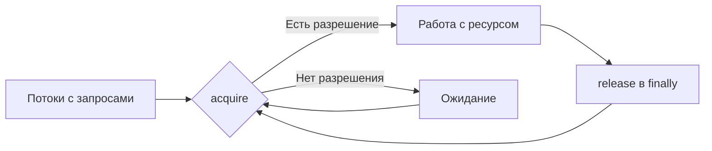

# Semaphore: ограничение одновременных операций

**CON-SEM · Java 21 · основа: Middle; дополнительные нюансы: Middle+**

**Семафор** (`java.util.concurrent.Semaphore`) — синхронизатор, хранящий число доступных **разрешений** (*permits*). Операция `acquire()` получает разрешение или ожидает его; `release()` добавляет разрешение. Семафор обычно ограничивает **число одновременных операций**, а не число созданных потоков.

## Для чего нужен

Пусть внешний сервис допускает не более трёх одновременных обращений. Создаём `Semaphore(3)`: каждый вызов перед обращением получает разрешение и обязательно возвращает его после завершения.



## Что делают методы

| Операция | Поведение |
|---|---|
| `new Semaphore(3)` | Изначально три разрешения |
| `acquire()` | Получает одно; если нет — ждёт; ожидание прерываемо |
| `tryAcquire()` | Немедленно возвращает `true` или `false` |
| `tryAcquire(timeout, unit)` | Ждёт не дольше заданного времени, возвращает результат |
| `release()` | Увеличивает число доступных разрешений |
| `availablePermits()` | Текущее число разрешений; **не** надёжная проверка для решения «можно ли войти» |

Минимальная корректная форма:

```java
Semaphore slots = new Semaphore(3);
slots.acquire();                     // Здесь возможно InterruptedException
try {
    callExternalService();
} finally {
    slots.release();                 // Только после успешного acquire
}
```

**Почему `finally`:** исключение во время `callExternalService()` не должно навсегда «терять» разрешение. Нельзя безусловно вызывать `release()`, если `acquire()` завершился исключением до получения разрешения.

## Важные отличия

- **`synchronized` / `ReentrantLock`** защищает критический участок взаимным исключением, обычно допуская одного владельца; семафор с тремя разрешениями допускает до трёх участников. `Semaphore(1)` похож на mutex, но **не имеет понятия владельца**: разрешение может вернуть другой поток.
- **`ExecutorService`** управляет выполнением задач; семафор ограничивает допуск к конкретному ресурсу и может применяться внутри уже работающего пула.
- **`BlockingQueue`** хранит и передаёт элементы; семафор сам ничего не хранит.

**Инвариант прикладного ограничения:** если каждый участник делает ровно один успешный `acquire()` перед работой и ровно один `release()` после неё, в защищённом участке одновременно работают не более `N` участников. Сам класс `Semaphore` не запрещает ошибочную лишнюю операцию `release()`.

> [!note]- Углубление: fairness и прерывания (Middle+)
> Конструктор `Semaphore(N, true)` включает политику справедливого порядка для ожидающих потоков на определённых точках выполнения. Она не гарантирует строгий порядок начала работы и может снижать пропускную способность.
>
> Методы `tryAcquire()` без аргументов не соблюдают fair-порядок даже для fair-семафора. Если ожидание прервано до получения разрешения, `acquire()` бросает `InterruptedException`, возвращать нечего. Прерывание — сигнал кооперативной отмены, а не принудительное завершение работы.

> [!note]- Углубление: гарантии памяти (Middle+)
> У `Semaphore` есть memory consistency guarantee: действия до вызова `release()` в одном потоке *happen-before* действиям после успешного `acquire()` в другом. Это не означает, что произвольные обращения к общим данным становятся потокобезопасными; границы протокола по-прежнему важны.

## Практика

[Самостоятельное упражнение: ограниченный сервис](../../exercises/concurrency/semaphore-limited-service/README.md) — реализация ограничения доступа с настоящим семафором и JUnit/Mockito. Оно объединяет семафор, прерывания, освобождение ресурса и тестирование внешней зависимости. Все необходимые для задачи понятия кратко описаны в её README; отдельные статьи о них будут добавляться в следующих итерациях.

## Источники

- [Java 21 API: Semaphore](https://docs.oracle.com/en/java/javase/21/docs/api/java.base/java/util/concurrent/Semaphore.html)
- [Java 21 API: InterruptedException](https://docs.oracle.com/en/java/javase/21/docs/api/java.base/java/lang/InterruptedException.html)
